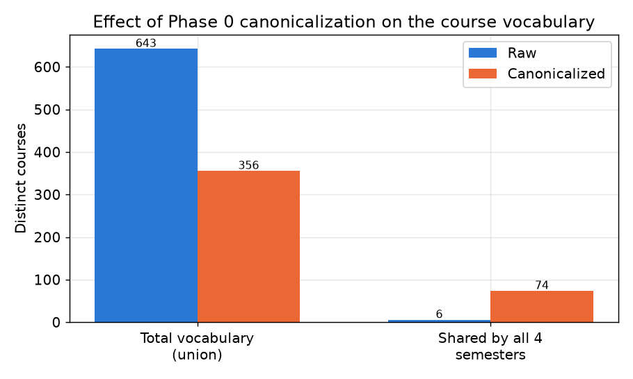
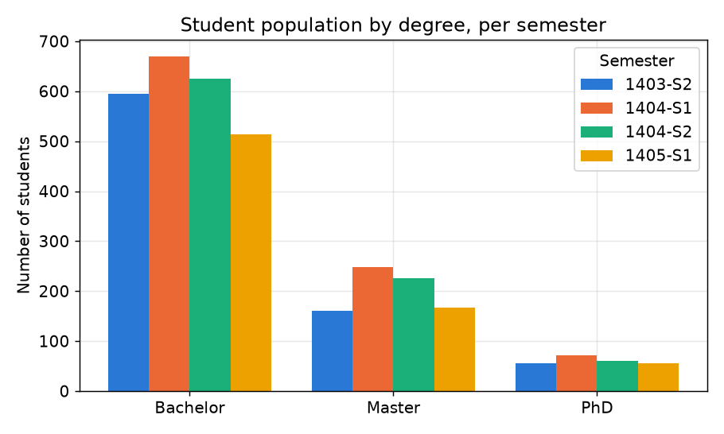
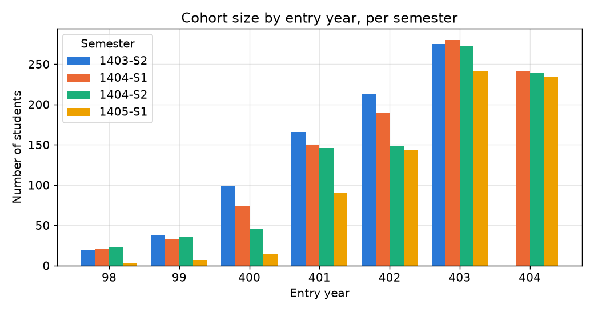
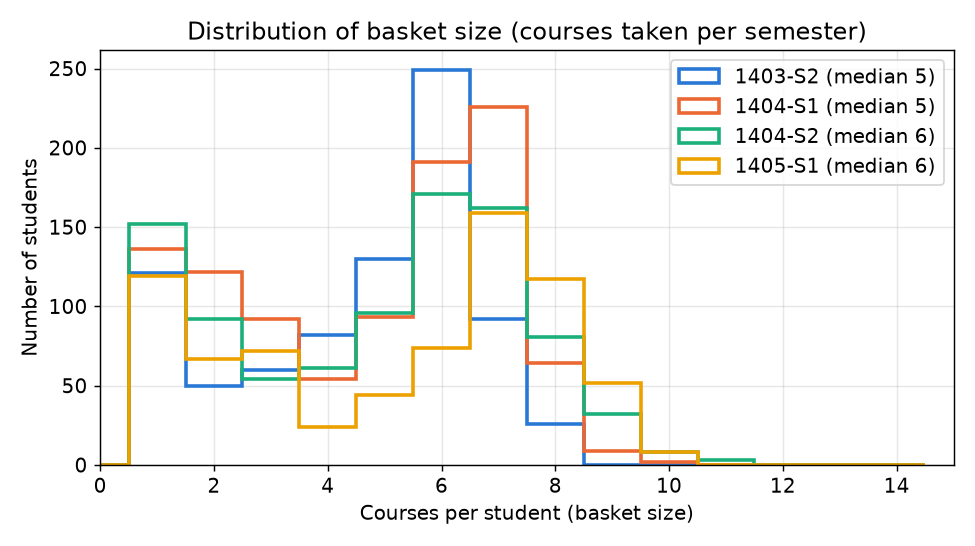
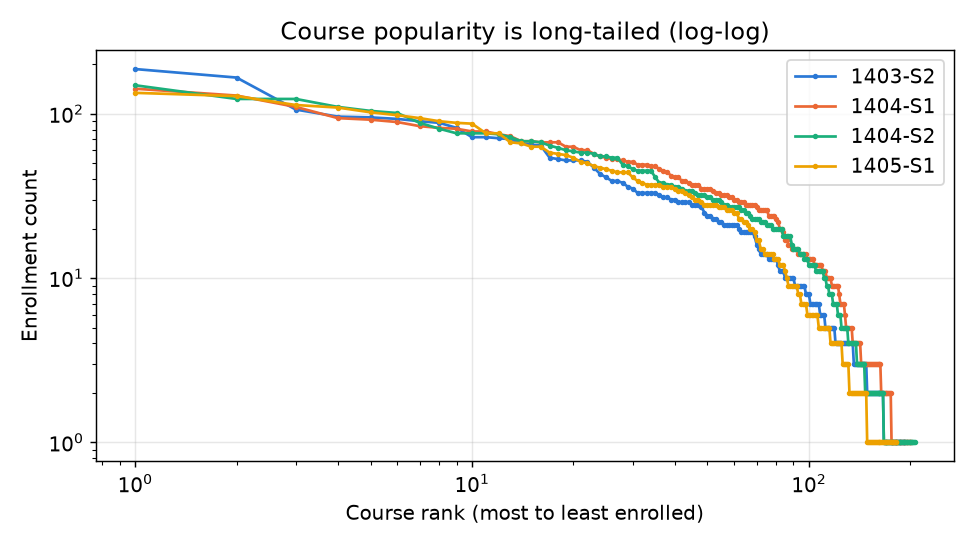

# Machine Learning on University Course-Enrollment Data

### A case study on Shahid Beheshti University course-taking behaviour

**Author:** Soroush
**Institution:** Shahid Beheshti University (SBU), Faculty of Mathematical Sciences (Faculty 22)
**Report last updated:** 2026-10-14
**Status:** Data foundation ready (four semester snapshots; collection + Phase 0 preprocessing complete) · Modeling task to be selected

---

## 1. Overview

This project studies **student course-taking behaviour** at Shahid Beheshti
University through machine learning. From a per-semester log of which courses
each student enrolled in, the goal is to learn structure that is not explicit in
the raw records: which courses are taken together, what distinct study profiles
exist, what a student is likely to take next, and what to recommend.

The report is organized around that machine-learning goal. Data collection and
cleaning are treated as the **foundation** that makes the modeling possible
(Sections 4–6); the analytical framing, exploratory findings, and candidate
learning tasks (Sections 3, 7–8) are the focus.

---

## 2. Objectives

- Frame course enrollment as a machine-learning problem over per-semester
  "baskets" of courses.
- Establish an analysis-ready data foundation: a clean, canonical course
  vocabulary shared across semesters, plus the representations models need.
- Characterize the data (sparsity, basket size, cohort structure) well enough to
  choose methods that are appropriate for its scale.
- Select and implement one modeling direction from the candidates in Section 8.

---

## 3. Machine-Learning Problem Framing

The data is **transactional**, not tabular: each student, in each semester,
is a *set* of enrolled courses. This is the same shape as market-basket data,
and it supports four complementary learning problems:

- **Unsupervised, within a semester** — co-enrollment structure (association
  rules) and student/course grouping (clustering).
- **Predictive, across semesters** — because the same students recur in
  consecutive snapshots, semester *t* → *t+1* transitions can be learned
  (next-course prediction). Some courses carry over between semesters
  (Section 7.4), so the target must be defined with care.
- **Personalized** — implicit-feedback recommendation from the student×course
  matrix.

Three properties of the data shape every method choice, and are quantified in
Section 7:

1. **Sparsity / long tail** — a few core courses dominate; most courses are rare.
2. **Small scale** — roughly 740–990 students and 180–210 courses per semester,
   favouring classical ML over deep models.
3. **Short history** — only three semester-to-semester transitions are available.

---

## 4. Data Foundation: Collection

Course lists are retrieved from the university's public course-list endpoint via
an HTTP POST keyed on a single student ID; the HTML response is parsed
(BeautifulSoup) into a list of enrolled courses. Student IDs are structured as
`Year + Degree + Faculty + Serial`, so the crawler enumerates plausible IDs and
keeps those returning a non-empty course list.

- **Degree** codes: `2` = Bachelor, `4` = Master, `5` = PhD.
- **Faculty** fixed at `22` (Mathematical Sciences).
- **Entry years** enumerated: 98 – 404. The 405 entering class had not yet
  started when the 1405 – Semester 1 snapshot was collected, so that snapshot
  has no first-term students.

Components: `Classes/DataRequest.py` (HTTP), `Classes/Student.py` (schema),
`Spider.py` (crawl + parse), `JSONModifier.py` (persistence and the `Semester`
field).

*Scope & ethics:* only publicly accessible course-list data is used — no grades
or private records — limited to Faculty 22.

---

## 5. Data Foundation: Dataset

The data is stored as **four consecutive-semester snapshots**, kept in separate
files so their chronological order — the basis of all longitudinal analysis — is
preserved. They are never merged; only the course vocabulary (Section 6) is
shared across them.

| File | Semester | Students | Course-instances (raw) |
|---|---|---|---|
| `data/22-4032.json` | 1403 – Semester 2 | 810 | 3,751 |
| `data/22-4041.json` | 1404 – Semester 1 | 989 | 4,729 |
| `data/22-4042.json` | 1404 – Semester 2 | 912 | 4,554 |
| `data/22-4051.json` | 1405 – Semester 1 | 736 | 3,853 |

**Record schema** (one student in one semester):

```json
{ "SBUID": "403222214", "Year": 403, "Degree": 2, "Faculty": 22,
  "Major": "", "CourseList": ["...", "..."], "Semester": 2 }
```

**Usable covariates:** `Year` (entry year), `Degree`, `Semester` — the
student's term number within their program, `2 × (current year − entry year) +
term` (e.g. a 403 entrant is in term 5 in 1405 – Semester 1). `Major` is empty
for all records; `Degree` is also recoverable from the ID.

**Cohorts.** Students per entry year in each snapshot (same data as the
entry-year figure in Section 7.1):

| Entry year | 1403-S2 | 1404-S1 | 1404-S2 | 1405-S1 |
|---|---|---|---|---|
| 98 | 19 | 21 | 23 | 3 |
| 99 | 38 | 33 | 36 | 7 |
| 400 | 99 | 74 | 46 | 15 |
| 401 | 166 | 150 | 146 | 91 |
| 402 | 213 | 189 | 148 | 143 |
| 403 | 275 | 280 | 273 | 242 |
| 404 | — | 242 | 240 | 235 |

The drop from 912 to 736 students in 1405 – Semester 1 has two causes. Students
past the nominal program length are graduating: the 98 – 400 cohorts shrank from
105 to 25, 401 Bachelor students (now in term 9) from 129 to 80, and 403 Master
students (term 5) from 81 to 58. In addition, the 405 cohort has not started yet.

**Longitudinal structure:** students are linked across snapshots by `SBUID`.
Consecutive pairs share 705 (1403-S2 → 1404-S1), 881 (→ 1404-S2) and 719
(→ 1405-S1) students; 610 students appear in the first three snapshots and 457
in all four. Each snapshot is that semester's enrollment, not a cumulative
transcript, but a returning student's course sets are **not** always disjoint:
thesis registrations and retaken courses recur (Section 7.4).

---

## 6. Data Foundation: Preprocessing (Phase 0)

Raw course names are heavily **fragmented**: across the four snapshots there are
643 distinct raw strings, yet only **6** are common to all four — an artefact of
inconsistent text rather than real course turnover. Causes: Arabic vs. Persian
letters (`ي/ی`, `ك/ک`; the 1404-S2 and 1405-S1 files use Arabic letters, the
earlier two Persian), section prefixes (`Gr01-…`), zero-width joiners, stray
trailing course-code suffixes, and lookalike spellings (`جزئی/جزیی`,
`فرآیند/فرایند`, `جبرخطی/جبر خطی`). Left uncleaned, this would corrupt every
frequency, co-occurrence, and similarity computation the models rely on.

`preprocessing.py` produces a single canonical form per course (raw files are
left untouched; outputs go to `data/canonical/`):

- Unicode NFKC; Arabic→Persian letter unification; ZWNJ/whitespace/digit
  normalization; removal of stray `(course-code)` suffixes.
- **Recitation classes merged into their parent course**
  (`Gr0N-کلاس حل تمرین X` → `X`).
- **Laboratory units kept separate** (`آزمایشگاه X` is its own course).
- **Numbered courses kept distinct** (`… 1` ≠ `… 2`).
- **Lookalike spellings merged.** Names that differ only by letters carrying a
  hamza/madda mark (`ئ/ی`, `آ/أ/إ/ا`, `ؤ/و`, `ۀ/ه`), or by a space that changes
  no letter shape (after a non-joining letter such as `ر`, or next to a digit),
  are treated as one course. The most frequent spelling becomes the canonical
  name. This merges 7 pairs, e.g. `مبانی بینائی کامپیوتر` → `مبانی بینایی
  کامپیوتر` and `جبرخطی عددی` → `جبر خطی عددی`.
- **Different names are never merged**, even when related:
  `یادگیری آماری` ≠ `یادگیری آماری مقدماتی`, `ریاضیات بیمه های زندگی` ≠
  `… مقدماتی`, `اصول حسابداری` ≠ `اصول حسابداری 1`. Names that differ by
  visible decoration also stay separate (`اصول حسابداری *2*` in 1404-S1 vs
  `اصول حسابداری 2` in 1405-S1).

Outputs: `course_vocab.json` (frozen canonical-name → integer id, **shared across
all snapshots** so a course has the same id everywhere), the per-snapshot
`*.canonical.json` files (with a parallel `CourseIDs` field), and
`raw_to_canonical.json` (audit trail).

**Result:** the vocabulary collapses from 643 raw strings to **356** canonical
courses (45% of raw strings were duplicates), and the number of courses common
to all four semesters rises from 6 to **74** — a 12× gain that confirms the
fragmentation was overwhelmingly orthographic.



---

## 7. Exploratory Data Analysis

The following characteristics directly inform the modeling choices in Section 8.
(All figures are regenerated by `eda_figures.py`. Axis labels use English/IDs
because course *names* are Persian; names are referenced in text instead.)

### 7.1 Cohort structure
The population is dominated by Bachelor students, with smaller Master and PhD
cohorts, and is spread across entry years 98–404 (counts in Section 5). The
degrees take almost entirely different courses: within a semester the Jaccard
overlap of any two degrees' course sets is at most 0.13. Several tasks are
therefore best run **stratified by degree** rather than pooled.





### 7.2 Basket size
Students take a **median of 5–6 courses per semester** (right-skewed, with a
notable group of 1–2-course students — 171 to 258 per semester). About 80% of
that group are Master and PhD students, typically registered for a thesis (`پایان نامه`),
dissertation (`رساله`) or comprehensive exam (`ارزیابی جامع`). This basket size
is comfortable for association-rule mining and defines the prediction target
size for next-course models.



### 7.3 Sparsity / long tail
Course popularity is **strongly long-tailed**. The top 10 courses account for
21–29% of a semester's enrollments, while 42–53% of courses have fewer than 10
enrollments that semester. On a log-log plot the curve is flat across the head
and falls off steeply past about rank 60, rather than following a straight power
law. This is the single most important constraint on modeling — rare courses give
unreliable co-occurrence and similarity estimates, so methods must use
support/frequency thresholds, regularization, or dimensionality reduction rather
than trusting raw counts.



### 7.4 Semester-to-semester dynamics
Three effects matter for any cross-semester model:

- **Carry-over courses.** About a quarter of returning students repeat at least
  one course in the next semester:

  | Transition | Linked students | Repeat ≥ 1 course |
  |---|---|---|
  | 1403-S2 → 1404-S1 | 705 | 217 (31%) |
  | 1404-S1 → 1404-S2 | 881 | 187 (21%) |
  | 1404-S2 → 1405-S1 | 719 | 169 (24%) |

  The repeats are mostly multi-semester registrations (`پایان نامه`, `رساله`)
  and retaken courses (`ریاضیات عمومی 1/2`, `معادلات دیفرانسیل`).
- **Fall/spring rotation.** 23 courses run (≥ 10 students) in both fall
  semesters but barely in spring, and 25 the other way round, so the course
  offering itself depends on the term.
- **Vocabulary turnover.** 26 canonical courses appear for the first time in
  1405-S1. The largest is `آمادگی در برابر حوادث و سوانح`, which is
  immediately the most-enrolled course of the semester (134 students).

---

## 8. Candidate Machine-Learning Tasks

All build on the Phase 0 canonical data. The specific task is **to be selected**;
no modeling has been implemented yet. Method choices reflect the EDA above
(small scale, sparse, long-tailed, three transitions).

| Task | Learning setting | Data representation | Suited methods | Key constraint |
|---|---|---|---|---|
| **Association rules** (co-enrollment) | Unsupervised, per semester | Basket list | Apriori / FP-Growth (support, confidence, lift) | Long tail → set support thresholds per degree |
| **Clustering** (student archetypes) | Unsupervised, per semester | Student×course matrix | SVD/NMF + K-Means / hierarchical; or course-co-occurrence communities | Cluster within degree; reduce dimensions first |
| **Recommendation** | Implicit feedback | Student×course matrix | Item-item CF / matrix factorization (ALS) | No negatives/ratings; small scale → classical CF |
| **Next-course prediction** | Supervised, cross-semester | `SBUID`-aligned *t*→*t+1* pairs | Markov transitions / multi-label classification | Only 3 transitions → no deep sequence models; handle carry-over courses and fall/spring rotation |

**Notes.**
- *Association rules* and *clustering* operate within a single snapshot and so
  respect the "keep snapshots separate" principle directly (run per semester,
  then compare across semesters).
- *Next-course prediction* is the only task requiring same-student linkage across
  snapshots. This is **alignment by `SBUID`**, not merging: the files stay
  separate; an index links a student's rows to form (semester *t* → *t+1*)
  training pairs (705 + 881 + 719 = 2,305 examples). Carry-over courses should
  either be removed from the target or predicted as a separate "continues"
  label; otherwise a model gets credit for predicting courses the student was
  already taking.

---

## 9. Reproducibility

Dependencies: `requests`, `beautifulsoup4`, `pandas`, `numpy`, `matplotlib`,
`bokeh` (dashboard).

```bash
python JSONModifier.py     # stamp the Semester field on the newest snapshot
python preprocessing.py    # Phase 0: regenerate data/canonical/ + vocabulary
python eda_figures.py      # regenerate assets/figures/*.png
```

Adding a snapshot: append its code to `SNAPSHOTS` in `preprocessing.py`, add a
label and a color to `SEM_LABELS` / `COLORS` in `eda_figures.py`, and update
the `addSemester(...)` call in `JSONModifier.py`.

---

## 10. Changelog

- **2026-10-14** — Added the 1405 – Semester 1 snapshot (`data/22-4051.json`,
  736 students; `Semester` field added). Canonicalization now merges
  lookalike-character spellings (7 pairs; vocabulary 363 → 356 over four
  snapshots). Corrected the earlier claim that a returning student's course sets
  are disjoint across semesters (new Section 7.4), and the description of the
  long tail. Updated all counts and figures to four snapshots; figure colors
  replaced with a color-vision-deficiency-safe palette.
- **2026-08-18** — Report reframed around the machine-learning objective (data
  collection/preprocessing recast as the supporting foundation). Added
  exploratory-data-analysis section with figures (`eda_figures.py`): degree and
  entry-year distributions, basket-size distribution, course-popularity long
  tail, and canonicalization impact.
- **2026-08-18** — Initial report. Data collection, dataset, and data-quality
  documentation; Phase 0 canonicalization implemented (`preprocessing.py`):
  561 → 335 canonical courses, shared vocabulary 7 → 95.
